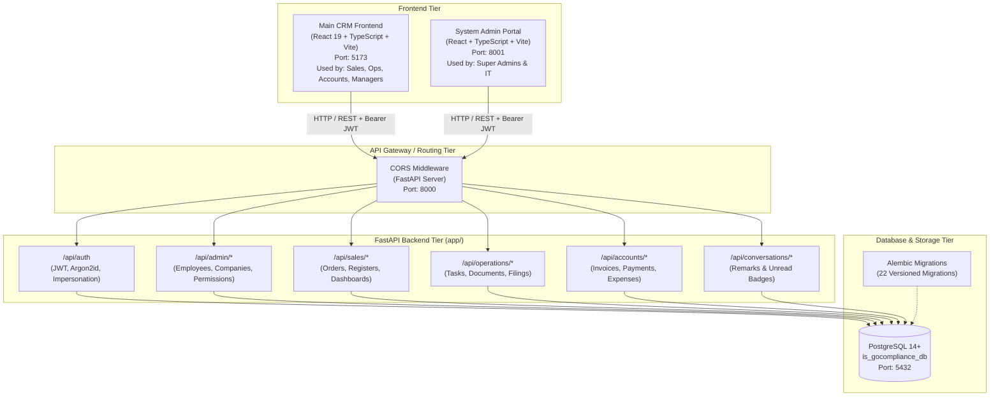
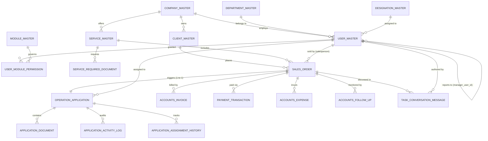
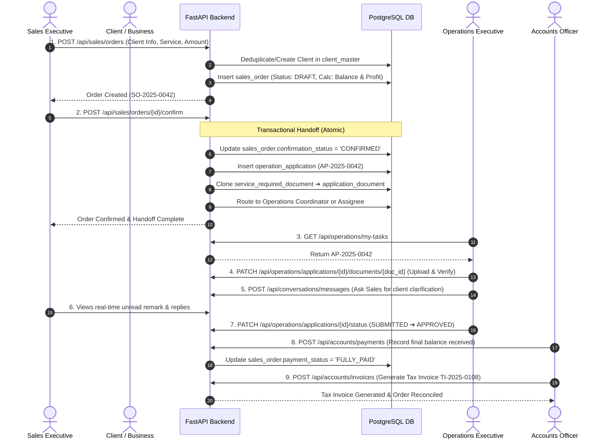

# GoCompliance CRM: Comprehensive Architecture & Project Guide

> **A Complete, In-Depth Technical Manual & Explanation Guide**  
> Written for developers, architects, and technical presentations to understand every aspect of the GoCompliance CRM platform: its business domain, architecture, data flows, database schema, FastAPI implementation, security model, and frontend design.

---

## Table of Contents
1. [Executive Summary & Business Purpose](#1-executive-summary--business-purpose)
2. [What is FastAPI? (Core Fundamentals & Why It Matters)](#2-what-is-fastapi-core-fundamentals--why-it-matters)
3. [High-Level System Architecture](#3-high-level-system-architecture)
4. [Database Architecture & Data Models (In-Depth)](#4-database-architecture--data-models-in-depth)
5. [Security, Authentication & Role-Based Access Control (RBAC)](#5-security-authentication--role-based-access-control-rbac)
6. [End-to-End Business Workflows & Data Flows](#6-end-to-end-business-workflows--data-flows)
7. [FastAPI Technical Deep Dive (Code Structure, Patterns & Functions)](#7-fastapi-technical-deep-dive-code-structure-patterns--functions)
8. [Frontend Architecture & Client-Server Integration](#8-frontend-architecture--client-server-integration)
9. [Interview & Presentation Guide (How to Explain This Project)](#9-interview--presentation-guide-how-to-explain-this-project)

---

## 1. Executive Summary & Business Purpose

### What is GoCompliance CRM?
**GoCompliance CRM** is an enterprise-grade multi-tenant Customer Relationship Management and Operations platform built for compliance, legal, tax, and corporate services firms (handling GST, Private Limited Company registration, Trademark filings, ISO certifications, Audits, etc.).

In compliance service firms, a customer engagement is not just a sales deal—it requires a coordinated handoff between three major departments:
1. **Sales Department**: Acquires the lead, discusses client requirements, collects advance payment, and issues draft/confirmed sales orders.
2. **Operations Department**: Takes the confirmed order, tracks statutory document requirements (e.g., PAN, Aadhaar, MOA/AOA), files applications with government portals (MCA, GST, Trademark registry), responds to government queries, and completes the compliance task.
3. **Accounts & Finance Department**: Tracks payment receipts, verifies advance vs. balance payments, generates Proforma and GST Tax Invoices, accounts for government fees vs. incidental costs, tracks outstanding dues, and calculates real-time profit margins.
4. **Administration & Executive Leadership**: Configures group companies, departments, designations, employee hierarchies, granular action permissions, and data visibility boundaries.

### Key Business Problems Solved by the CRM
* **Elimination of Departmental Silos**: Automatically transforms a confirmed Sales Order into an Operations Application with document checklists and Accounts billing entries without manual data re-entry.
* **Multi-Company Group Architecture**: Supports multiple sister entities under one parent umbrella (e.g., *GoCompliances*, *Enterpernership*, *BrandMingo*), each with distinct employee codes, branding, and billing.
* **Strict Hierarchical & Scoped Data Privacy**: Prevents unauthorized employees from viewing deals or clients outside their designated team, department, or company.
* **Audit-Proof Financial & Operational History**: Every reassignment, status transition, payment approval, and remark is stamped with the user, timestamp, and audit trail.

---

## 2. What is FastAPI? (Core Fundamentals & Why It Matters)

### 2.1 What is FastAPI?
**FastAPI** is a modern, high-performance web framework for building RESTful APIs with Python 3.8+ based on standard Python type hints. It is built on top of two core foundational libraries:
1. **Starlette**: A lightweight, lightning-fast ASGI (Asynchronous Server Gateway Interface) framework for handling HTTP requests, WebSockets, background tasks, routing, and middleware.
2. **Pydantic**: A powerful data validation and parsing library that enforces strict type annotations and automatically serializes/deserializes JSON objects.

```
       ┌────────────────────────────────────────────────────────┐
       │                       FastAPI                          │
       │    (Routing, Dependency Injection, Swagger Docs, RBAC) │
       └───────────────────────────┬────────────────────────────┘
                                   │
              ┌────────────────────┴───────────────────┐
              ▼                                        ▼
    ┌──────────────────┐                     ┌──────────────────┐
    │    Starlette     │                     │     Pydantic     │
    │ (ASGI Engine,    │                     │ (Data Validation,│
    │  HTTP Requests,  │                     │  Serialization,  │
    │  CORS, Routing)  │                     │  Type Checking)  │
    └──────────────────┘                     └──────────────────┘
```

### 2.2 Why FastAPI instead of Django or Flask?
When building an enterprise CRM API, FastAPI offers distinct advantages:

| Feature | Flask | Django REST Framework (DRF) | FastAPI (Used in GoCompliance) |
| :--- | :--- | :--- | :--- |
| **Performance** | Moderate (synchronous WSGI) | Moderate (synchronous WSGI) | **Extremely High** (native async ASGI, comparable to NodeJS / Go) |
| **Data Validation** | Manual (or requires external libs like Marshmallow) | Serializers (verbose, tightly coupled to Django ORM) | **Automatic via Pydantic** (validates request bodies, query params, headers using native Python types) |
| **Documentation** | Requires manual plugins (Swagger/Flasgger) | Requires external packages (`drf-yasg` / `drf-spectacular`) | **Zero-Config Interactive Docs** generated automatically at `/docs` (Swagger UI) and `/redoc` (ReDoc) |
| **Type Safety** | None by default | Limited | **100% Type-Hint Driven**, caught at compile/lint time via mypy/IDE |
| **Dependency Injection** | Manual or global application contexts | Class-based views / middleware | **Built-in `Depends()` system**, allowing composable auth, DB sessions, and RBAC guards |

### 2.3 Key FastAPI Superpowers Used in GoCompliance CRM
1. **Automatic Request Validation**: If an endpoint expects a valid `UUID` or `Decimal` value, FastAPI automatically checks the payload before your business logic even executes. If invalid, it returns a standardized HTTP 422 Unprocessable Entity error.
2. **Dependency Injection Pipeline (`Depends`)**: Rather than manually opening database connections or parsing JWT headers in every route, FastAPI executes dependencies in a chain:
   ```
   HTTP Request 
     ──▶ Depends(oauth2_scheme)         [Extracts Bearer Token]
     ──▶ Depends(get_db)                [Opens SQLAlchemy Session]
     ──▶ Depends(get_current_user)      [Validates JWT & DB User]
     ──▶ Depends(require_permission)    [Checks RBAC Rules & Data Scope]
     ──▶ Controller Route Handler       [Executes Business Logic]
   ```
3. **Interactive OpenAPI (Swagger) Documentation**: Every endpoint, schema, and query parameter declared in `app/api/*.py` is immediately documented and testable in the browser at `http://localhost:8000/docs`.

---

## 3. High-Level System Architecture

GoCompliance CRM is architected as a decoupled, multi-service platform for maximum maintainability and separation of operational concerns.

### System Topology Diagram



### Service Port Map
* **Port 5173 (`frontend/`)**: Main CRM Single Page Application (SPA).
* **Port 8001 (`admin-frontend/`)**: Dedicated Administrative Portal for company master data, employee onboarding, and system credentials.
* **Port 8000 (`backend/`)**: FastAPI REST API Service.
* **Port 8000/docs**: Interactive Swagger UI API documentation.
* **Port 5432 (`PostgreSQL`)**: Authoritative relational database storage.

### The Unified Development Launcher (`scripts/dev.sh` & `npm run dev`)
Rather than forcing developers to open 3 separate terminals, activate virtual environments, and manually start services, a single root command runs pre-flight port checks, virtual environment validation, and launches all 3 services concurrently with color-coded log prefixes (`[backend]`, `[frontend]`, `[admin]`). On `Ctrl+C`, it gracefully terminates all child processes.

---

## 4. Database Architecture & Data Models (In-Depth)

The database runs on **PostgreSQL** utilizing **SQLAlchemy 2.0 ORM** and **Alembic** migrations. The schema is normalized into three distinct architectural layers: **Master Tables**, **Operational Business Tables**, and **Security & Audit Tables**.

### 4.1 Complete Entity-Relationship (ER) Overview



---

### 4.2 Core Tables & Field Definitions

#### 1. Master & Organizational Entities
* **`company_master`**: Multi-tenant group companies (`GOCOMPLIANCES`, `ENTERPERNERSHIP`, `BRANDMINGO`). Stores official company legal name, tax info, active status, and `employee_code_prefix` (`CG`, `EP`, `BM`).
* **`department_master`**: Standardized company departments (`Sales`, `Operations`, `Accounts`, `Administration`, `HR`).
* **`designation_master`**: Hierarchy levels (`Director`, `Manager`, `Team Lead`, `Executive`, `Associate`).
* **`user_master`**: Core user accounts & employee master:
  * `user_id`: Primary Key (UUIDv4).
  * `employee_code`: Unique formatted sequence (e.g., `CG0001`, `EP0001`). Generated atomically.
  * `manager_user_id`: Self-referencing Foreign Key pointing to the employee's direct manager. Forms a company-wide reporting tree.
  * `password_hash`: High-security **Argon2id** password hash. Plaintext passwords are never stored.
  * `account_status`: `PENDING`, `ACTIVE`, `INACTIVE`, `SUSPENDED`.
  * `token_version`: Integer incremented on logout or password change to invalidate older JWTs immediately.
  * `must_change_password`: Boolean requiring initial trial users to set a permanent password before accessing business modules.

#### 2. Client & Service Catalog
* **`client_master`**: Client organizations and individuals. Includes client name, contact person, mobile number, email, and entity type (`PRIVATE_LIMITED`, `LLP`, `INDIVIDUAL`, `PROPRIETORSHIP`).
* **`service_master`**: Compliance services offered (`GST Registration`, `Trademark Filing`, `Private Limited Incorporation`, `Annual Compliance`). Stores standard government fees and professional charges.
* **`service_required_document`**: The predefined document checklist template for each service (e.g., "PAN Card", "Aadhaar Card", "Electricity Bill", "Digital Signature Certificate").

#### 3. Sales & Deal Management
* **`sales_order`**: Represents a closed or draft commercial engagement:
  * `order_number`: Formatted sequential code (e.g., `SO-2025-0001`).
  * `salesperson_user_id`: Employee who closed the deal.
  * `order_value`: Total contractual amount.
  * `amount_received`: Advance amount collected up-front.
  * `balance_amount`: Outstanding amount (`order_value - amount_received`).
  * `govt_fees`: Statutory government charges required for the application.
  * `incidental_cost`: Courier, stamp paper, notary charges.
  * `profit_amount`: Calculated net margin (`order_value - govt_fees - incidental_cost`).
  * `payment_status`: `PENDING`, `PARTIALLY_PAID`, `FULLY_PAID`, `OVERDUE`.
  * `confirmation_status`: `DRAFT`, `CONFIRMED`, `CANCELLED`.
  * `gst_invoice_required`: Boolean flag requesting formal tax invoicing.

#### 4. Operations & Task Execution
* **`operation_application`**: Created automatically when a sales order is confirmed:
  * `application_number`: Formatted sequential tracking code (e.g., `AP-2025-0001`).
  * `sales_order_id`: 1-to-1 foreign key to `sales_order.order_id` (enforced via unique constraint for idempotency).
  * `application_status`: Workflow states:
    * `UNASSIGNED` ➔ `ASSIGNED` ➔ `IN_PROGRESS` ➔ `PENDING_DOCUMENTS` ➔ `READY_FOR_SUBMISSION` ➔ `SUBMITTED` ➔ `AUTHORITY_QUERY` ➔ `APPROVED` / `CANCELLED`.
  * `priority`: `LOW`, `MEDIUM`, `HIGH`, `URGENT`.
  * `assigned_to_user_id`: Operations executive currently executing the task.
* **`application_document`**: Tracks individual checklist documents cloned from `service_required_document`:
  * `status`: `PENDING`, `UPLOADED`, `VERIFIED`, `REJECTED`.
  * `file_path`, `original_filename`, `verified_by_user_id`.
* **`application_activity_log` & `application_assignment_history`**: Immutable timestamped event log of every assignment, status change, and internal note.

#### 5. Accounts & Financial Control
* **`accounts_invoice`**: Proforma and GST Tax Invoices generated against sales orders with auto-generated serials (`PI-YYYYMM-XXXX`, `TI-YYYYMM-XXXX`).
* **`payment_transaction`**: Individual payment installments received (Cash, NEFT, UPI, Cheque), reference numbers, and reconciliation status.
* **`accounts_expense`**: Additional expenses incurred during task execution deducted from deal profitability.
* **`accounts_follow_up`**: Dues recovery workflow tracking scheduled follow-up dates and remarks.

#### 6. Cross-Department Communication
* **`task_conversation_message`**: Real-time collaborative discussion thread tied directly to an order/application. Allows Sales, Operations, and Accounts to converse within the record context.
* **`task_conversation_read_state`**: Tracks the last read message timestamp per user to render real-time unread badges in the navigation bar.

---

## 5. Security, Authentication & Role-Based Access Control (RBAC)

The security model of GoCompliance CRM is one of its strongest technical highlights.

```
┌────────────────────────────────────────────────────────────────────────┐
│                        FastAPI Security Layer                          │
├──────────────────────────────────┬─────────────────────────────────────┤
│ 1. Identity & Credentials        │ Argon2id Hashing (Memory-Hard)       │
├──────────────────────────────────┼─────────────────────────────────────┤
│ 2. Session Management            │ Dual JWT (Access: 14d, Refresh: 30d)│
├──────────────────────────────────┼─────────────────────────────────────┤
│ 3. Instant Revocation            │ token_version Check in Postgres     │
├──────────────────────────────────┼─────────────────────────────────────┤
│ 4. Granular Action Rights        │ can_view, create, edit, delete...   │
├──────────────────────────────────┼─────────────────────────────────────┤
│ 5. Data Scopes (Server-Enforced) │ SELF, TEAM (CTE), DEPT, COMP, ALL   │
└──────────────────────────────────┴─────────────────────────────────────┘
```

### 5.1 Dual-Token JWT Authentication Flow
1. **User Submits Credentials** (`POST /api/auth/login`): Email/employee code + password.
2. **Argon2id Verification**: The password is verified against `password_hash`. Argon2id is resistant to GPU-based brute-force attacks.
3. **Account State Verification**: The user must be `account_status == "ACTIVE"`, not locked by failed attempts, and within allowed login thresholds.
4. **Token Generation**:
   * **Access Token**: Short/medium-lived JWT containing `sub` (user UUID), `token_version`, and claims.
   * **Refresh Token**: Long-lived cryptographic token stored securely in `refresh_token` table.
5. **State Revocation (`token_version`)**: If an employee is terminated or changes their password, `token_version` is incremented. All previously issued JWTs are rejected immediately without waiting for token expiry.

### 5.2 The 2-Tier Permission Model: Actions + Data Scopes
Permissions are stored per user and per module in `user_module_permission`:

#### Tier 1: Action Flags
* `can_view`: Read records.
* `can_create`: Author new records.
* `can_edit`: Update existing records.
* `can_delete`: Remove records (restricted strictly to Super Admin).
* `can_approve`: Approve status transitions, payments, or task completions.
* `can_assign` & `can_reassign`: Delegate work to other team members.
* `can_export`: Download CSV and report files.

#### Tier 2: Server-Enforced Data Scopes
Even if two users have `can_view = True`, they see entirely different subsets of data based on their `data_scope`:

| Data Scope | Meaning | How the Backend Enforces It |
| :--- | :--- | :--- |
| **`SELF`** | Only records created by or assigned to the user. | `WHERE salesperson_user_id = current_user.user_id` |
| **`TEAM`** | The user and all direct/indirect recursive subordinates. | **PostgreSQL Recursive CTE** traversing `manager_user_id` hierarchy tree. |
| **`DEPARTMENT`** | All records belonging to users within the same department. | `WHERE company_id = user.company_id AND department_id = user.department_id` |
| **`COMPANY`** | All records across the entire company. | `WHERE company_id = user.company_id` |
| **`ALL`** | Global cross-company visibility (Directors, Super Admins). | No company or employee filter applied. |

---

### 5.3 Technical Highlight: Recursive CTE for `TEAM` Scope
To prevent infinite loops if an administrative error creates a circular reporting line (e.g., A reports to B, B reports to C, C reports to A), the backend implements a **cycle-safe PostgreSQL Common Table Expression (CTE)** with path tracking:

```sql
WITH RECURSIVE subordinates AS (
    -- 1. Base Query: The current manager
    SELECT user_id, manager_user_id, 1 AS depth, ARRAY[user_id] AS path
    FROM user_master
    WHERE user_id = :root_manager_id

    UNION ALL

    -- 2. Recursive Query: Find reports where manager is in previous set
    SELECT u.user_id, u.manager_user_id, s.depth + 1, s.path || u.user_id
    FROM user_master u
    JOIN subordinates s ON u.manager_user_id = s.user_id
    WHERE NOT (u.user_id = ANY(s.path))  -- Prevents cyclic recursion loops
      AND s.depth < :max_depth           -- Safety limit (default: 50)
)
SELECT user_id FROM subordinates;
```
* **Why this is impressive to explain**: It demonstrates an understanding of graph theory, database recursion, and safety mechanisms against stack overflows.

---

### 5.4 Super Admin Impersonation ("Login as Employee")
Super Admins have the ability to inspect the CRM from the perspective of any employee to troubleshoot issues:
* **Security Guard**: Available only if the feature flag `ENABLE_ADMIN_IMPERSONATION=true` is enabled.
* **Audit Trail**: Every impersonation session creates an `impersonation_session` and logs every API invocation into `impersonation_audit_log`.
* **Privilege Drop**: During an impersonation session, destructive administrative operations (like deleting users or modifying global settings) are strictly blocked.

---

## 6. End-to-End Business Workflows & Data Flows

Let us trace the entire lifecycle of a customer engagement from lead to filing completion.



### Detailed Breakdown of Workflow Phases

#### Phase 1: Deal Inception (Sales)
1. Sales rep receives inquiry for "Private Limited Incorporation" (Service Value: ₹15,000, Govt Fees: ₹3,000, Incidental: ₹500).
2. Rep enters data in `SalesEntryPage.tsx`. The client pays an advance of ₹5,000.
3. Backend validates:
   * Advances cannot exceed the total order value.
   * Calculates `balance_amount = ₹10,000`.
   * Calculates `profit_amount = ₹15,000 - ₹3,000 - ₹500 = ₹11,500`.
   * Sets `payment_status = "PARTIALLY_PAID"`.
   * Generates order number `SO-2025-0042`.

#### Phase 2: The Idempotent Operations Hand-off
1. When client documents and advance are verified, Sales clicks **Confirm Order**.
2. Endpoint `POST /api/sales/orders/{id}/confirm` executes an atomic database transaction:
   * Marks `sales_order.confirmation_status = "CONFIRMED"`.
   * Checks if an application already exists for this order (prevents duplicate tasks).
   * Generates application number `AP-2025-0042`.
   * Resolves the configured **Operations Coordinator** for the company or assigns the selected team member.
   * Queries `service_required_document` for the selected service and inserts an empty checklist into `application_document`.
   * Posts an initial conversation remark in `task_conversation_message`.

#### Phase 3: Operations Execution & Document Verification
1. The Operations team member sees the new task on `MyTasksPage.tsx`.
2. As documents arrive from the client, the status of each checklist item moves from `PENDING` to `UPLOADED` and `VERIFIED`.
3. If the government issues a query (e.g., MCA name rejection), the task status is changed to `AUTHORITY_QUERY`.
4. Once the incorporation certificate is downloaded, the task is marked `APPROVED`.

#### Phase 4: Accounts Reconciliation & Invoice Generation
1. Accounts receives the remaining balance of ₹10,000.
2. In `PaymentRegisterPage.tsx`, the payment is recorded with payment mode (NEFT) and bank transaction ID.
3. Balance drops to ₹0, and `payment_status` automatically updates to `FULLY_PAID`.
4. Accounts issues a final Tax Invoice (`TI-2025-XXXX`) with formal GST calculation.

---

## 7. FastAPI Technical Deep Dive (Code Structure, Patterns & Functions)

Let us examine how the backend code is organized and review key production patterns.

### 7.1 Backend Directory Structure
```
backend/
├── alembic/                  # Database schema migrations
│   └── versions/             # 22 migration scripts tracking schema changes
├── app/
│   ├── api/                  # API Controllers / Endpoints (FastAPI APIRouter)
│   │   ├── auth.py           # Login, logout, refresh, impersonation
│   │   ├── sales.py          # Sales dashboard, register, orders
│   │   ├── operations.py     # Operations tasks, checklists, statuses
│   │   ├── accounts.py       # Invoices, payments, expenses, follow-ups
│   │   ├── conversations.py  # Chat threads, unread notifications
│   │   ├── employees.py      # Employee CRUD, status changes, credentials
│   │   └── deps.py           # FastAPI Dependency Injection (Auth, DB, RBAC)
│   ├── core/
│   │   ├── config.py         # Pydantic BaseSettings (Environment variables)
│   │   └── security.py       # Argon2id password hashing, PyJWT encoding
│   ├── database/
│   │   ├── base.py           # SQLAlchemy declarative Base
│   │   └── session.py        # Connection pooling engine & get_db dependency
│   ├── models/               # SQLAlchemy ORM Database Models
│   ├── schemas/              # Pydantic v2 Request/Response Data Validation Schemas
│   ├── scripts/              # CLI tools (bootstrap_super_admin, seed data)
│   └── services/             # Pure Business Logic Layer (sales, ops, permissions)
├── main.py                   # FastAPI Application Factory & CORS Config
└── requirements.txt          # Python dependencies
```

---

### 7.2 FastAPI Dependency Injection in Action (`app/api/deps.py`)

FastAPI's dependency injection system makes code modular, testable, and clean.

#### 1. Database Session Management (`get_db`)
```python
def get_db() -> Generator[Session, None, None]:
    """Yield an active SQLAlchemy session and guarantee cleanup on completion."""
    db: Session = SessionLocal()
    try:
        yield db
    finally:
        db.close()
```
* **Why it matters**: Guarantees that every HTTP request gets its own isolated database transaction and closes the connection back into the pool even if an unhandled exception occurs.

#### 2. Reusable Permission Dependency Factory (`require_module_permission`)
```python
def require_module_permission(module_code: str, action: str = "view"):
    """Factory creating a FastAPI dependency that verifies per-user module rights."""
    def _permission_dependency(
        current_user: User = Depends(require_fully_activated_user),
        session: Session = Depends(get_db),
    ):
        if not permissions.has_permission(session, current_user, module_code, action):
            raise HTTPException(
                status_code=status.HTTP_403_FORBIDDEN,
                detail=f"Access denied for module '{module_code}'. Insufficient privileges.",
            )
        return permissions.get_user_module_permission(session, current_user.user_id, module_code)

    return _permission_dependency
```
* **How it is used in a route**:
```python
@router.post(
    "/orders",
    response_model=SalesOrderDetailRead,
    dependencies=[Depends(require_module_permission("SALES_CONFIRMED_ORDER", "create"))],
)
def create_sales_order(
    data: SalesOrderCreate,
    current_user: User = Depends(get_current_active_user),
    session: Session = Depends(get_db),
):
    return sales_service.create_sales_order(session, data, current_user)
```
* Notice how clean the controller is: authentication, database connection, and role-based permissions are already validated before line 1 of the function executes!

---

### 7.3 Pydantic Schemas vs. SQLAlchemy Models
A common point of confusion for beginners is: *"Why do we have two definitions for User and SalesOrder?"*

| Concept | Library | Purpose | Example File |
| :--- | :--- | :--- | :--- |
| **SQLAlchemy Model** | `sqlalchemy` | Represents the **physical database table**, columns, foreign keys, and SQL constraints. | `app/models/user.py` |
| **Pydantic Schema** | `pydantic` | Represents the **HTTP contract** (what the client sends and what the server returns). | `app/schemas/user.py` |

#### Why this separation is critical for security:
* When returning an employee profile via `GET /api/admin/employees/{id}`, the SQLAlchemy model contains `password_hash`, `token_version`, and `failed_login_attempts`.
* The Pydantic response schema (`EmployeeRead`) explicitly omits these fields.
* Even if an engineer queries `session.get(User, id)`, FastAPI and Pydantic will **never serialize `password_hash` to JSON**. Secrets cannot leak over the wire.

---

### 7.4 Concurrency Row-Locking (`SELECT ... FOR UPDATE`)
When generating sequential employee codes (`CG0001`, `CG0002`):
If two HR managers create an employee at the exact same millisecond, a standard `SELECT COUNT(*)` would assign both the same code, causing a unique constraint crash.

GoCompliance CRM solves this in `app/services/employee_code.py` using **PostgreSQL Row-Level Locking**:
```python
stmt = (
    select(Company)
    .where(Company.company_id == company_id)
    .with_for_update()  # Locks this specific company row in PostgreSQL
)
company = session.execute(stmt).scalar_one_or_none()
# Generate next employee code and update next_number atomically
```
* The second transaction is forced to wait until the first transaction commits, guaranteeing zero duplicate codes and zero race conditions.

---

## 8. Frontend Architecture & Client-Server Integration

The frontend is built using **React 19**, **TypeScript**, **Vite**, and **Tailwind CSS**.

### 8.1 State Management & Architecture
Rather than introducing heavy Redux boilerplate, the frontend uses clean **React Context API** modules:
1. **`AuthContext.tsx`**: Manages current user profile, JWT storage in `localStorage`, role resolution, and client-side route authorization helpers (`hasPermission`, `canAccessModule`).
2. **`RemarkNotificationContext.tsx`**: Periodically queries conversation unread counts and powers the interactive notification bell.
3. **`ThemeContext.tsx`**: Dark/Light mode theme state persisted across sessions.

### 8.2 Client-Side Route Protection (`ProtectedRoute.tsx`)
```tsx
<Route
  path="/sales/orders"
  element={
    <ProtectedRoute requiredModule="SALES" requiredAction="view">
      <SalesRegisterPage />
    </ProtectedRoute>
  }
/>
```
If an unauthenticated user or an unauthorized employee tries to access `/sales/orders`:
1. If not logged in ➔ Redirected to `/login`.
2. If temporary password not set ➔ Redirected to `/change-password-required`.
3. If lacking module access ➔ Redirected to `/unauthorized` with a clear explanation.

### 8.3 Axios Interceptors for Token Refresh
The Axios HTTP client in `frontend/src/api/client.ts` automatically attaches the Bearer token to all outgoing requests. If the server responds with a 401 Unauthorized, the interceptor attempts to refresh the session using the refresh token before redirecting to the login screen.

---

## 9. Interview & Presentation Guide (How to Explain This Project)

Use these concise, high-impact scripts to present the project in job interviews or technical reviews.

### 9.1 The 30-Second Elevator Pitch
> *"GoCompliance CRM is a full-stack enterprise platform built with FastAPI, PostgreSQL, and React 19. It solves operational fragmentation in compliance and legal services firms by seamlessly connecting Sales, Operations, and Accounts. When a sales rep confirms a deal, the system automatically provisions an operational compliance task with statutory document checklists and establishes financial tracking. It features strict 2-tier role-based access control, server-enforced data visibility boundaries powered by recursive PostgreSQL CTEs, and zero-trust credential management."*

---

### 9.2 The 2-Minute Architectural Walkthrough
> *"The system is architected as a decoupled multi-service application. On the backend, we use FastAPI on Python 3.10 with SQLAlchemy 2.0 and Alembic. We chose FastAPI for its native async ASGI performance, automated Pydantic schema validation, and powerful dependency injection engine.*
>
> *On the database side, we run PostgreSQL with a heavily normalized schema containing 22 versioned migrations. Security is enforced through a two-tier RBAC system: first, granular action flags like view, create, edit, and approve; second, multi-tier data scopes ranging from SELF to TEAM, DEPARTMENT, COMPANY, and ALL.*
>
> *For the TEAM scope, we wrote a cycle-safe recursive Common Table Expression in PostgreSQL that dynamically resolves reporting trees through the manager foreign key without risk of infinite loops.*
>
> *The frontend consists of two Vite React SPAs: a dedicated Admin Portal and the Main CRM. Communication is secured via Argon2id password hashing and dual-token JWTs with token versioning for instant session revocation."*

---

### 9.3 Top 10 Technical Questions & Answers

#### Q1: Why did you choose FastAPI over Django or Flask?
**Answer**:  
FastAPI gives us the best of both worlds: the high asynchronous performance of Node.js/Go thanks to Starlette, combined with automatic type validation via Pydantic. Unlike Flask, we get built-in Swagger documentation at `/docs` without third-party plugins. Unlike Django, it is lightweight, async-first, and does not lock us into a monolithic ORM or template engine.

#### Q2: How does your Role-Based Access Control (RBAC) work?
**Answer**:  
We implemented a two-tier system: **Action Rights** and **Data Scopes**. Action rights dictate *what* you can do (view, create, edit, approve, export), while Data Scopes dictate *what data* you can see (SELF, TEAM, DEPARTMENT, COMPANY, ALL). This is enforced server-side using FastAPI dependencies (`require_module_permission`), ensuring client-side tampering cannot bypass data boundaries.

#### Q3: How do you prevent infinite loops in the employee reporting hierarchy?
**Answer**:  
When fetching team data recursively, a cycle could occur if employee A reports to B and B reports to A. We wrote a PostgreSQL Recursive CTE using an array path accumulator: `WHERE NOT (u.user_id = ANY(s.path))` and capped the maximum recursion depth. If a cycle exists, the CTE detects that the node was already visited and stops traversing.

#### Q4: How is data consistency maintained between Sales and Operations?
**Answer**:  
The handoff is atomic and idempotent. In `confirm_sales_order`, we use a single database transaction: we check if an `OperationApplication` already exists for that `order_id` (enforced by a 1-to-1 unique constraint in PostgreSQL). If not, we generate the application, copy the checklist from `service_required_document`, route it to the company's Operations Coordinator, and commit. If any step fails, the entire transaction rolls back.

#### Q5: How do you prevent race conditions when generating sequential employee codes like `CG0001`?
**Answer**:  
We use PostgreSQL row-level locking via SQLAlchemy's `.with_for_update()` on the `company_master` table. When an employee is created, the company row is locked until the transaction commits, ensuring concurrent requests cannot read the same sequence number and create duplicates.

#### Q6: Why do you have both Pydantic schemas and SQLAlchemy models?
**Answer**:  
SQLAlchemy models define the physical database schema, tables, and relationships. Pydantic schemas define the HTTP request and response contracts. This separation allows us to sanitize data: sensitive internal fields like `password_hash` or `token_version` are present in the SQLAlchemy model but excluded from the Pydantic response schema, preventing accidental data leaks.

#### Q7: How does JWT session revocation work if tokens are stateless?
**Answer**:  
We store an integer `token_version` in the `user_master` table and embed it in the JWT payload. On every authenticated request, our `get_current_user` dependency compares the token's version against the database. If an employee logs out, changes passwords, or is suspended, we increment `token_version` in PostgreSQL, immediately invalidating all existing access tokens.

#### Q8: What password hashing algorithm did you use, and why?
**Answer**:  
We used **Argon2id** (via `pwdlib` / `argon2-cffi`). Argon2 won the Password Hashing Competition and is superior to standard bcrypt or SHA-256 because it is memory-hard, making it extremely resistant to brute-force attacks running on specialized GPU or ASIC hardware.

#### Q9: How do multiple companies exist in a single CRM database?
**Answer**:  
We use a shared-database, discriminator-column multi-tenant architecture. The `company_master` table defines each entity. Tables like `user_master`, `sales_order`, and `operation_application` contain a `company_id` foreign key. The backend server automatically applies `WHERE company_id = current_user.company_id` unless the user holds global `ALL` scope permissions.

#### Q10: How does the cross-department conversation feature work?
**Answer**:  
We created `task_conversation_message` linked to `sales_order_id`. Any team member with access to the order can post notes. A secondary table, `task_conversation_read_state`, records the timestamp of each user's last view. When the frontend polls `/api/conversations/unread-summary`, the server compares message creation timestamps against the read state to calculate real-time unread badge counts for the notification bell.

---

## 10. Summary & Quick Reference Sheet

| Domain | Key Technology / Pattern | Key Code Files |
| :--- | :--- | :--- |
| **API Framework** | FastAPI (Python 3.10+) | `backend/app/main.py` |
| **Database ORM** | SQLAlchemy 2.0 + Psycopg 3 | `backend/app/database/session.py` |
| **Database Migrations** | Alembic (22 versions) | `backend/alembic/versions/` |
| **Database Engine** | PostgreSQL 14+ | Relational schema (`is_gocompliance_db`) |
| **Data Validation** | Pydantic v2 | `backend/app/schemas/*.py` |
| **Password Security** | Argon2id Hashing | `backend/app/core/security.py` |
| **Authentication** | Dual JWT + `token_version` | `backend/app/api/deps.py` |
| **Hierarchy Traversal** | Recursive PostgreSQL CTE | `backend/app/services/permissions.py` |
| **Concurrency Control** | `SELECT ... FOR UPDATE` row locks | `backend/app/services/employee_code.py` |
| **Frontend Framework** | React 19 + TypeScript + Vite | `frontend/src/App.tsx` |
| **Styling** | Tailwind CSS + Lucide Icons | `frontend/src/index.css` |
| **API Client** | Axios + Bearer Interceptors | `frontend/src/api/client.ts` |
